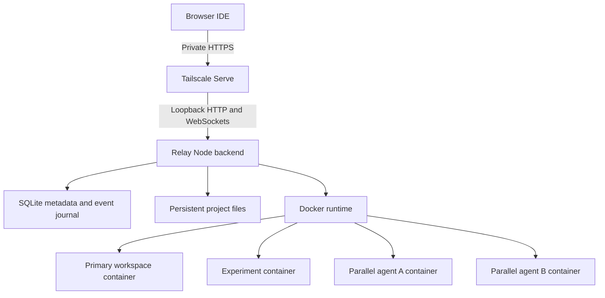

# Relay first implementation

## Agreed scope

One private owner, one Linux VM, trusted personal repositories, normal Codex login, persistent project state, browser code editing, and user-created experiments/parallel agents. No Relay MCP integration, Git worktrees, recursive delegation, automatic merges, public multi-user hosting, or local model inference.

The code editor is integrated CodeMirror rather than code-server in this first build. This gives Relay its own file explorer, tabs, syntax highlighting, search, and saves. Language servers, extensions, debugging, file rename/delete, and app preview routing are future additions.

## Components

The backend runs on the host and owns Docker. Containers receive only their project directory and the shared Codex home; they never receive the Docker socket. The owner may import a repository using host Git authentication, but host SSH configuration is not mounted into project containers.

Remote access is delegated to Tailscale Serve and its access rules. Relay has no login token or session cookie and only binds to `127.0.0.1`. Its access module checks the loopback peer, allowed Host, browser fetch metadata, and mutation/WebSocket origins. These checks prevent common cross-site and DNS-rebinding paths; they do not authenticate local processes or distinguish Tailscale users. Every permitted caller has full control. Existing token files/settings are ignored. Local development accesses the same service directly over loopback.

The browser layout module owns resizable panels, left/right Codex docking, visibility, terminal maximization, and the command palette. It saves dimensions and visibility to browser localStorage, clamps panels to the viewport, and uses overlays on small screens. Tabs reorder within one editor group and preserve each open file's CodeMirror state, including undo history. Floating windows and split editor groups are not implemented.

The default interface is the task workspace: Tasks, Experiments, and Review. Code exposes the existing IDE as a secondary view. The same conversation/approval DOM is moved between task detail and the IDE, preserving listeners, event cursors, and prompt drafts. View changes keep the editor mounted; workspace changes retain the existing unsaved-change confirmation. Task cards use actual persisted run states, and command summaries report recorded exit codes without inferring test success.

`POST /api/workspaces/:id/tasks` accepts a task name, prompt, and explicit `isolated` boolean. Isolated tasks use the existing snapshot/queue operation and free their worker container on completion. Direct tasks enqueue against the chosen workspace. Optional run titles preserve compatibility with older stored runs. Experiments group by snapshot group ID. Review requests generate stored proposals on demand; the browser displays changed files and two-column diff hunks, or two proposals together. Applying one result can make its sibling stale: comparison does not bypass full-snapshot conflict checks. Binary changes remain applicable but use a notice instead of a text diff. Large text previews are bounded; full patches remain downloadable.

Authentication and Codex session history share a persistent `/codex` mount across containers. This deliberately uses the agreed trusted-repository model. Project code can potentially access the Codex login and other Codex session records. Project source trees are separate. This implementation does not claim strong credential isolation.

Codex runs inside each execution container through `docker exec -i ... codex app-server`. Its default commands and file tools therefore operate inside that container. Relay uses the stable RPC surface and disables built-in multi-agent feature flags; the Relay UI owns parallel task creation. Resource controls bound the container even though this is not a hostile-code sandbox.

## Data model

`Workspace` is persistent source state. Its kind is primary, experiment, or parallel agent. A Docker container is deterministically named and labeled for that workspace. `AgentRun` is one task/turn with an independent state and journal. A workspace stores its Codex thread ID so later prompts resume its conversation.

SQLite uses WAL and full synchronization. The initial schema consists of a typed-record table and an indexed event journal. Each event has a global increasing sequence number; fetching by run and cursor preserves order even when different runs interleave. Large task event output is capped at 16 MiB per run. Patches are limited to 8 MiB. Automatic history retention/compaction is not implemented yet.

The browser receives change notifications over WebSockets and retrieves durable events by HTTP cursor. Reconnection fetches everything after the last cursor. Slow WebSocket consumers are disconnected and can catch up later. PTYs have separate, bounded in-memory terminal scrollback.

## Workspace snapshots and review

1. The source agent must be idle. The UI asks the owner to save browser edits first.
2. The backend serializes workspace mutations and temporarily pauses a running source container while it captures files.
3. Git identifies tracked files and eligible untracked files. Dirty tracked contents and deletions are reflected in the copy.
4. Snapshot rules exclude dependency/build directories, Git internals, `.codex`, `.ssh`, and `.env` files other than example files. Ignored untracked files are excluded. Tracked files outside these exclusions remain included.
5. The snapshot is limited to 20,000 entries and 128 MiB. Symlinks, special files, and submodule working trees are rejected.
6. Each copy gets an independent Git repository and a baseline commit. Parallel copies come from the same captured in-memory file set.
7. Review uses a temporary index to compare baseline contents with current eligible files, including new files and deletions, without changing the real Git index.
8. An approved proposal checks the complete primary snapshot fingerprint and the reviewed source fingerprint, then runs `git apply --check` followed by `git apply` while both containers are paused.

Primary divergence is deliberately conservative: even an unrelated eligible change rejects automatic application. The owner can inspect both files and resolve the difference manually. Applying a proposal does not commit or push. A source workspace can be promoted only once; create a fresh experiment for further work.

## Resource scheduling

Defaults: two active agent tasks total; three running environments; 0.5 CPU and 2 GiB RAM per environment; 256 processes per container; one hour per task, including approval waiting. The scheduler also reserves 1.5 GiB for the host and checks aggregate configured CPU/RAM against detected host resources. Adjust settings to the actual VM.

All admission and owner mutations are serialized in one backend process. Additional tasks remain in SQLite's FIFO queue. Only one active or queued task may own a workspace. The parallel UI launches two tasks; the API accepts two through eight.

Parallel worker containers stop automatically at task completion to release capacity. Their files survive for review. Primary and manually created experiment environments remain available until stopped. Idle primary/experiment containers count toward capacity, so queued tasks can require stopping one of those environments.

## Cancellation and recovery

- Browser disconnect: Codex and the PTY continue under the backend.
- Task cancellation: stop the whole workspace container so shell descendants terminate too. Retain files/history. Other workspaces continue.
- Backend shutdown: active tasks are stopped and marked interrupted; queued tasks remain queued.
- Backend crash: on restart, verify Docker state, stop any uncertain prior active execution, and mark its task interrupted. Do not automatically re-run its prompt.
- Docker offline: preserve queued work and retry. Environment state becomes unknown. A failed stop remains in `stopping` until termination can be confirmed.
- Container crash: the attached Codex transport closes and the run fails. Persistent files remain.
- VM reboot: the service restarts and reconciles. Start an environment or submit a new prompt to continue a stored thread.
- Partially completed imports/snapshots/discards: durable operation records and installation/workspace labels enable cleanup.
- Interrupted promotion: keep its operation record as `needs-review`; never replay the patch automatically. The owner must inspect the primary workspace. The operation journal is stored in SQLite and has no dedicated UI yet.

Filesystem writes, Git operations, Docker operations, and SQLite are not one transaction. Recovery records intended actions and reconciles external effects. The V1 contract is preservation and truthful interruption, not uninterrupted execution across a backend restart.

## Verification limits

Tests use real Git, SQLite, HTTP, and a browser. Container scheduling tests use a simulated runtime and simulated Codex protocol transport. Docker was unavailable on the development host, so container image execution, ARM64 compatibility, actual device login, approval prompts from real Codex, and live task reconnect require the VM acceptance checklist.

Protocol references: [Codex app-server](https://learn.chatgpt.com/docs/app-server), [Docker resource controls](https://docs.docker.com/engine/containers/resource_constraints/).
